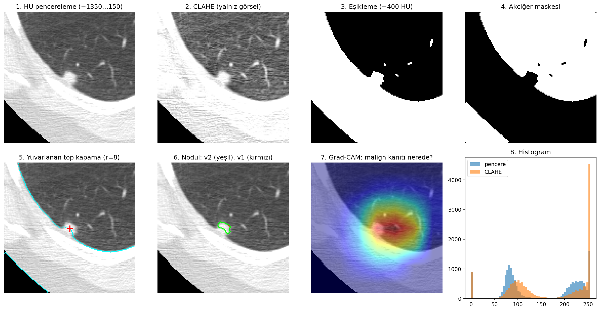
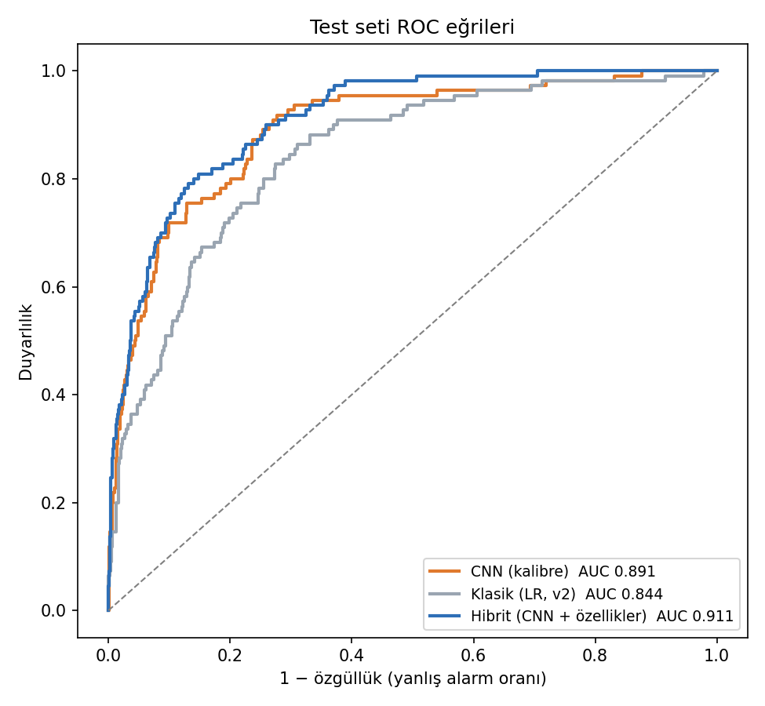

# BT Görüntülerinde Akciğer Nodülü Malignite Sınıflandırması

**Görüntü İşleme dersi proje ödevi** · Konu: Medikal Görüntülerden Hastalık Tespiti
Tekirdağ Namık Kemal Üniversitesi, Bilgisayar Mühendisliği · Ekip: Hilâl Gökçe Sarıçam, Aynur Dinçer, Esma Özadanır

Akciğer tomografisinde (BT) görülen bir nodülün **kötü huylu (malign)** mu **iyi huylu (benign)** mu olduğunu görüntüden tahmin ediyoruz. Üç yaklaşımı karşılaştırdık:

1. **Klasik görüntü işleme:** pencereleme → bölütleme (Otsu, morfoloji, watershed, uyarlamalı “yuvarlanan top” kapama) → 9 özellik → lojistik regresyon
2. **Derin öğrenme:** ResNet-18 (ImageNet ön eğitimli, transfer öğrenme)
3. **Hibrit:** CNN skoru + 9 görüntü işleme özelliği → lojistik regresyon



---

## Sonuçlar

**5 katlı çapraz doğrulama** (hasta bazında; test seti kullanılmadan):

| Model | ROC-AUC | PR-AUC |
|---|---|---|
| Klasik (bölütleme v2 + lojistik regresyon) | 0,789 ± 0,027 | 0,312 |
| CNN (ResNet-18) | 0,849 ± 0,021 | 0,476 |
| **Hibrit (CNN + özellikler)** | **0,861 ± 0,026** | **0,502** |

**Kilitli test seti** (1177 kayıt, 110 malign, 424 hasta; %95 güven aralığı hasta düzeyinde bootstrap):

| Model | ROC-AUC | %95 GA | PR-AUC |
|---|---|---|---|
| Klasik | 0,844 | 0,800–0,889 | 0,430 |
| CNN | 0,891 | 0,841–0,933 | 0,533 |
| **Hibrit** | **0,911** | **0,878–0,941** | **0,587** |

- Tarama eşiğinde (doğrulamada %90 duyarlılık): hibrit model testteki **110 kanserin 108'ini** yakaladı (özgüllük %60).
- Bölütleme v2, kör değerlendirmede doğru maske oranını **18/40'tan 28/40'a** çıkardı.
- Şeffaflık notu: test seti iki kez kullanıldı (ilk ölçüm bölütleme düzeltmesinden önce, Adım 22). Bütün model ve eşik kararları yalnız doğrulama verisiyle verildi; ana sonuç olarak çapraz doğrulama değerleri verilmelidir.



---

## Kullanılan görüntü işleme yöntemleri ve ders karşılıkları

| İşlem | Python | MATLAB karşılığı | Ders |
|---|---|---|---|
| HU pencereleme (kontrast germe) | `np.clip` + doğrusal ölçekleme | `imadjust` | 3 |
| Histogram eşitleme / CLAHE | `exposure.equalize_hist` / `equalize_adapthist` | `histeq` / `adapthisteq` | 3 |
| Medyan, Gauss, bilateral filtre | `ndimage.median_filter`, `gaussian_filter`, `denoise_bilateral` | `medfilt2`, `imgaussfilt`, `imbilatfilt` | 4 |
| Kenarı tekrarlayan dolgu | `np.pad(mode="edge")` | `padarray(..., 'replicate')` | 4 |
| Otsu eşikleme | `filters.threshold_otsu` | `graythresh` | 5 |
| Açma / kapama / delik doldurma | `binary_opening`, `binary_closing`, `binary_fill_holes` | `imopen`, `imclose`, `imfill` | 6 |
| Morfolojik sınır β(A) = A − (A ⊖ B) | `binary_erosion` | `imerode` | 6 |
| Sobel kenar gradyanı | `filters.sobel` | `edge(f, 'sobel')` | 6 |
| Bağlantılı bileşen, bölge özellikleri | `measure.label`, `regionprops` | `bwlabel`, `regionprops` | — |
| Watershed | `segmentation.watershed` | `watershed` | — |

**Bölütleme v2 (uyarlamalı yuvarlanan top):** Duvara yapışık bir nodül, akciğer maskesinde sınırda bir girinti gibi görünür. Akciğer maskesine disk(r) ile kapama uygulanınca girinti kapanır ve nodül akciğerin içine alınır. Her nodül için, nodülü içine alan **en küçük r** seçilir (2–40 piksel). Kapama, uzaklık dönüşümüyle hesaplanır (`src/goruntu_isleme.py → kapama_hizli`): `binary_closing` ile aynı sonucu yaklaşık 12 kat hızlı verir. Buzlu cam nodüller için ikinci bir eşik (−750 HU) kullanılır.

---

## Veri

[LUNA25](https://luna25.grand-challenge.org/) (2025), NLST taramalarından:
- Görüntüler: Zenodo [14223624](https://zenodo.org/records/14223624) — CC BY 4.0
- Etiketler: Zenodo [14673658](https://zenodo.org/records/14673658) — CC BY-NC 4.0 (ticari olmayan kullanım)

6163 nodül kaydı (3762 farklı nodül, 2120 hasta), 555 malign kayıt (348 nodül). Her kayıt 64×128×128 vokselik, ham HU değerli bir blok. Veri bu repoda yoktur; 1. defter Zenodo'dan indirir.

---

## Kullanım kılavuzu

### Gereksinimler
- Google Colab (önerilen; T4 GPU) ya da Python 3.10+ ve CUDA destekli bir GPU
- Google Drive'da yaklaşık 2 GB boş alan (işlenmiş diziler ve modeller)
- Paketler: `requirements.txt`

### Adım adım çalıştırma
1. `notebooks/1_veri_on_isleme_cnn.ipynb` defterini Colab'da açın, **Çalışma zamanı → Çalışma zamanı türünü değiştir → T4 GPU** seçin.
2. Hücreleri sırayla çalıştırın. Defter veriyi indirir, hasta bazında böler, ön işlemeyi yapar, CNN'i 5 kat için eğitir ve sonuçları Drive'daki `akciger_nodul_LUNA25/` klasörüne kaydeder (CNN eğitimi kat başına ~3 dakika).
3. `notebooks/2_bolutleme_v2_hibrit_demo.ipynb` defterini açın. İlk hücre veriyi ve modelleri Drive'dan yükler, Gradio arayüzünü başlatır ve bir `https://….gradio.live` bağlantısı verir.
4. Sonraki hücreler bölütleme v2'yi, model karşılaştırmasını ve test ölçümünü çalıştırır. **Demo v2** hücresi güncel arayüzü başlatır.

### Arayüz (demo)
- Kaydırıcıdan bir test nodülü seçin ya da **Rastgele malign / Rastgele benign** düğmesine basın, sonra **Analiz et**'e basın.
- Arayüz 8 panel gösterir: pencereleme, CLAHE, eşikleme, akciğer maskesi, yuvarlanan top kapama, nodül maskesi (yeşil: v2, kırmızı kesikli: v1), Grad-CAM ve histogram.
- Tabloda üç modelin malignite olasılığı ve iki eşikteki kararı (tarama ve dengeli) ile kararın doğru olup olmadığı yazar.
- Açılışta demo, raporlanan test tahminlerini yeniden hesaplar; fark 0 çıkmalıdır.

### Fonksiyonları tek başına kullanma
```python
import numpy as np
from src.goruntu_isleme import pencere, bolutle_v2, ozellik_cikar

k = pencere(hu_kesiti)                  # 128×128 HU kesiti → 0–1
maske, bilgi = bolutle_v2(k, ayrinti=True)
print(bilgi["r"], ozellik_cikar(k, maske))
```

---

## Dosya yapısı

```
├── notebooks/
│   ├── 1_veri_on_isleme_cnn.ipynb         # Adım 1–25: veri, ön işleme, bölütleme v1, CNN, ilk test
│   └── 2_bolutleme_v2_hibrit_demo.ipynb   # Adım 26–28: bölütleme v2, hibrit, son test, Gradio demo
├── src/
│   └── goruntu_isleme.py                  # pencereleme, morfoloji, bölütleme v1/v2, özellikler
├── figures/                               # rapor ve sunum görselleri
├── requirements.txt
└── LICENSE
```

Defterler Colab'da çalıştırıldıkları sırayla ve çıktılarıyla birlikte duruyor; her adımın başında ne yapıldığını anlatan bir başlık var.

---

## Sınırlılıklar
- Yalnızca 3 kesit (2,5B) kullanıldı; bloğun tamamı (3B) kullanılmadı.
- Mediastene geniş tabanla yapışık büyük kitlelerde bölütleme hâlâ zayıf.
- Kör bölütleme değerlendirmesi 40 örnekle ve bir yapay zekâ değerlendiriciyle yapıldı.
- Tek veri kaynağı (NLST); dış doğrulama yapılmadı. Bu bir araştırma prototipidir, tanı aracı değildir.

## Yapay zekâ kullanımı
Kod yazımında, analiz planında ve metin taslaklarında Claude (Anthropic) kullanıldı. Bütün kodlar ekip tarafından Colab'da çalıştırıldı ve her çıktı kontrol edildi. Kör bölütleme değerlendirmesinde yöntemleri bilmeyen ayrı bir yapay zekâ değerlendirici kullanıldı.

## Kaynaklar
- Otsu, N. (1979). A Threshold Selection Method from Gray-Level Histograms. *IEEE Trans. SMC.*
- Zuiderveld, K. (1994). Contrast Limited Adaptive Histogram Equalization. *Graphics Gems IV.*
- He, K. ve ark. (2016). Deep Residual Learning for Image Recognition. *CVPR.*
- Selvaraju, R. R. ve ark. (2017). Grad-CAM. *ICCV.*
